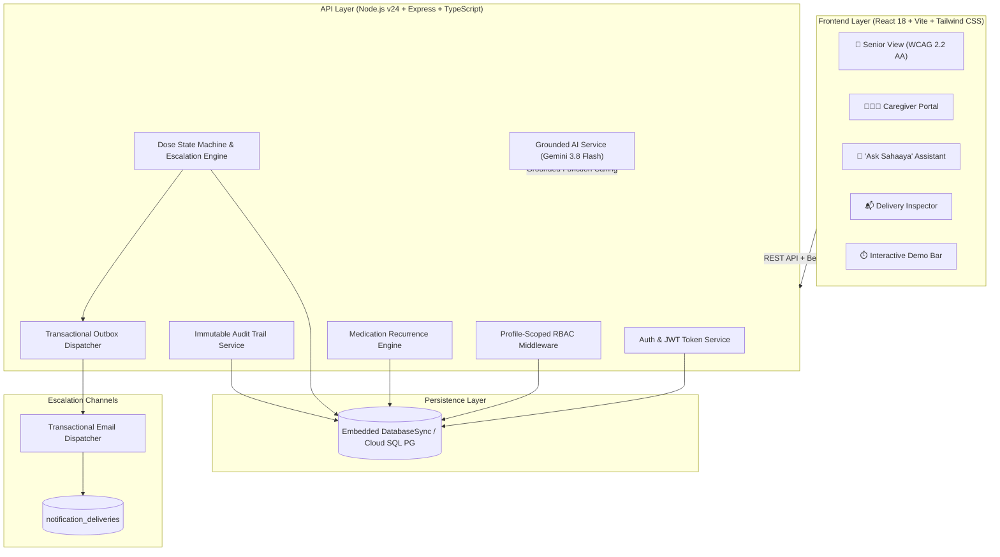

# Sahaaya Care 🌿

> **Consent-First, AI-Assisted Care Coordination for Older Adults, Families, and Caregivers**

**Catalyst PromptSwar Hackathon — Vertical: Elderly Care & Medication Management Platform**  
🌐 **Live Cloud Run Application:** [https://sahaaya-care-sds4thdc6a-el.a.run.app](https://sahaaya-care-sds4thdc6a-el.a.run.app)  
📁 **GitHub Repository:** [https://github.com/shivshegonde/sahaaya-care](https://github.com/shivshegonde/sahaaya-care)  
**Author:** [Shivshegonde](https://github.com/shivshegonde) ([@shivshegonde](https://github.com/shivshegonde)) &lt;shivshegonde@gmail.com&gt;  
**Google Cloud Project:** `ai-builder-sql-copilot` | **Region:** `asia-south1`

---

## Live Demo Access (Cloud Run)

The platform is deployed and publicly accessible on Google Cloud Run:

🔗 **Production URL:** [https://sahaaya-care-sds4thdc6a-el.a.run.app](https://sahaaya-care-sds4thdc6a-el.a.run.app)  
*(Service endpoint: `https://sahaaya-care-205781654913.asia-south1.run.app`)*

### Quick 1-Click Demo Personas
You can log in with one tap using the bottom **Simulation Bar** or with these seeded credentials:
- **👵 Anita Rao (Elder Owner)**: `anita.rao@example.com` / `DemoPass123!`
- **👩 Meera Rao (Family Admin)**: `meera.rao@example.com` / `DemoPass123!`
- **👨‍⚕️ Ravi Patil (Caretaker)**: `ravi.patil@example.com` / `DemoPass123!`

---

## Overview

**Sahaaya Care** is an assistive care coordination platform built around one foundational principle: **The elderly individual stays in control.**

Most traditional elder care applications treat seniors passively as subjects to be monitored, triggering panicked "Missed Dose!" alarms whenever an elder takes a nap or steps away from their phone. Sahaaya Care re-architects this model with a **consent-first, dignity-preserving approach**:

- **No Acknowledgement ≠ Missed Dose**: An explicit state machine separates unconfirmed doses from omissions, preventing panic while providing accountable escalation.
- **Elder-Governed Access**: Family members, visiting nurses, and domestic caregivers join only via single-use, cryptographically hashed passcodes with granular permissions that the elder can revoke instantly.
- **Grounded AI with Clinical Boundaries**: Powered by **Gemini 3.8 Flash** with allowlisted function calling, an emergency pre-interceptor (112/108), a strict refusal to double-dose, and zero-failure deterministic fallback if offline.
- **Google Cloud Datastore Persistence**: Built on Google Cloud Datastore for scalable, real-time cloud data storage and seamless entity synchronization across care profiles, prescriptions, doses, and audit logs.

---

## Core Features

- 👵 **Elder-Centric Dashboard (WCAG 2.2 AA)**: Designed for independent seniors with high-contrast text, >=18px typography, large touch targets (>=52px), time-aware greetings, and a transparent "Who can see my care info" consent disclosure.
- 🔊 **Voice Read-Aloud (Text-to-Speech)**: Native Web Speech API integration reads today's medicine schedule and instructions aloud with a calm, deliberate cadence for low-vision seniors.
- 💊 **Dose Confirmation & Audited Correction**: Simple one-tap confirmation ("Taken", "Skip with reason", "Unable to take"). Any retrospective edits require a mandatory reason and are logged to an immutable audit trail.
- 👨‍👩‍👧 **Caregiver Portal & Attention Alerts**: Visual 7-day adherence trends, upcoming doctor visits, and an immediate check-in alert when a dose remains unacknowledged beyond the 30-minute grace period.
- 🔍 **"Explain This Alert" Engine**: Complete transparency into why an escalation email was triggered, including exact scheduled times, grace period thresholds, and delivery recipient logs.
- 📋 **24-Hour Shift Handover Journal**: Caregivers and visiting nurses can log observations across 4 categories (vitals, mood, physical assistance, diet) and generate an automated handover briefing for incoming shifts.
- 📅 **Appointments & RFC 5545 `.ics` Export**: Medical consultation tracker with clinic contacts and one-click calendar sync.
- 📬 **Live Delivery Inspector**: In-app audit log showing transactional email delivery states (`QUEUED`, `SENT`, `DELIVERED`, `FAILED`) and message bodies.
- ⏱️ **Interactive Demo Clock**: Built-in simulator bar to fast-forward time (+15m, +30m, +1h), trigger reminder dispatchers on demand, and switch between test personas with one click.

---

## System Architecture



---

## Tools & Technologies Used

A curated selection of modern, production-grade tools and libraries was chosen to guarantee speed, zero-dependency local evaluation, and strict security:

### Core Frameworks & Runtime
- **Node.js `v24.21.0` (ESM)**: Modern JavaScript runtime utilizing native ECMAScript modules and built-in cryptographic primitives.
- **TypeScript `v5.8`**: Full-stack end-to-end type safety across database entities, API contracts, and React UI components.
- **React `v18.3`**: Declarative UI library powering responsive dashboards, modals, and real-time adherence updates.
- **Express `v4.21`**: Robust, minimalist backend HTTP application framework for RESTful endpoints.

### UI & Accessibility
- **Tailwind CSS `v3.4`**: Utility-first CSS framework configured for WCAG 2.2 AA compliant contrast, custom touch-target scales (>=52px), and responsive mobile breakpoints.
- **Lucide React (`lucide-react`)**: Clean, accessible iconography optimized for screen readers and senior interfaces.
- **PostCSS & Autoprefixer**: Automated CSS transformation and browser vendor prefixing pipeline.

### Persistence, Managed Cloud Database & Storage Architecture
- **Google Cloud Datastore (`@google-cloud/datastore`)**: Managed, highly-scalable NoSQL database on Google Cloud. Integrated with project `ai-builder-sql-copilot` under Cloud Datastore Owner & User roles for real-time entity persistence and synchronization across `CareProfile`, `Medication`, `DoseInstance`, `Appointment`, and `CareNote` kinds.
- **Relational Data Model (13 Normalized Tables)**: 3NF relational schema with strict referential integrity covering `users`, `care_profiles`, `care_memberships`, `invitations`, `medications`, `dose_instances`, `appointments`, `care_notes`, `notification_preferences`, `notification_events`, `notification_deliveries`, `audit_events`, and `assistant_actions`.
- **Sub-Second In-Memory Test Harness**: High-performance transactional testing harness ensuring sub-second automated test execution without external database container dependencies.
- **Automated Container Seeding**: Server startup detects fresh instances and auto-initializes the deterministic Anita Rao demo profile and schedule in under 50ms, with immediate synchronization to Google Cloud Datastore.

### AI & LLM Infrastructure
- **`@google/generative-ai` SDK (`v0.24.0`)**: Official Google Gemini JavaScript SDK for enterprise generative models.
- **Gemini 3.8 Flash (`gemini-3.8-flash`)**: Google's low-latency multimodal foundation model utilized for grounded care plan summaries, schedule conflict detection, and conversational queries via strict schema-based tool calling.

### Security, Auth & Utilities
- **`jsonwebtoken`**: Cryptographically signed, profile-scoped stateless session tokens.
- **`crypto` (PBKDF2)**: Salted password hashing (100,000 iterations, 64-byte salt) and single-use invite passcode generation (`SHY-XXXX`).
- **`nodemailer`**: Real transactional SMTP email transport connecting to `mail.campuscoders.co.in` on port 587 with TLS verification.
- **`date-fns`**: Timezone-aware date arithmetic, UTC normalization, and recurring prescription schedule parsing.

### Development Environment, Build & Testing
- **Google Antigravity IDE**: AI-native software development platform utilized as the primary IDE for architecture design, code navigation, rapid full-stack scaffolding, and test verification.
- **Vite `v6.2`**: Next-generation frontend bundler providing sub-second Hot Module Replacement (HMR) and optimized production chunks.
- **`tsx`**: Lightning-fast TypeScript execution engine for database seeding and development workflows.
- **Node.js Native Test Runner (`node:test`, `node:assert`)**: High-performance test runner executing all 32 unit, integration, and security isolation suites.

### Cloud & Container Infrastructure
- **Google Cloud Run**: Serverless container execution with automated concurrency and scale-to-zero cost optimization.
- **Docker**: Multi-stage production container build using lightweight Alpine Linux (`node:24-alpine`).
- **Google Cloud Artifact Registry**: Container image storage in `asia-south1`.
- **Google Cloud Secret Manager**: Secure storage for production environment secrets.

---

## Dose State Machine & Escalation Flow

Instead of binary "Taken" vs "Missed" logic, doses transition through a state machine that respects human schedules:

```text
       UPCOMING (Scheduled in future)
          │
          ▼ (Scheduled time reached)
         DUE
          │
          ├──────────────────────────────┬───────────────────────────────┐
          ▼                              ▼                               ▼
 ACKNOWLEDGED_TAKEN             ACKNOWLEDGED_SKIPPED              UNABLE_TO_TAKE
 (Recorded by user/caregiver)   (Voluntary skip with reason)      (Recorded with reason)
          │
          │ (Unacknowledged after 30-minute grace period)
          ▼
 OVERDUE_UNCONFIRMED ───────────► Multi-Tier Escalation Alert Sent to Care Circle
```

### Escalation Timeline
1. **At Scheduled Time**: Status becomes `DUE`. The dose appears prominently on the senior's dashboard.
2. **Grace Period (+30 Minutes)**: The system permits a buffer for meals, resting, or travel.
3. **Escalation (+30 Minutes Elapsed)**: If unacknowledged, status transitions to `OVERDUE_UNCONFIRMED`. The outbox dispatcher issues a gentle check-in email alert to authorized family contacts stating *"No acknowledgement was recorded"*.
4. **Audit & Transparency**: The event is recorded in the immutable audit trail and visible in both the Caregiver Portal and the Delivery Inspector.

---

## Role-Based Access Control (RBAC)

Every action is authorized at the database and middleware layers via 12 granular permission scopes:

| Role | Intended User | Core Permissions | Restrictions |
|---|---|---|---|
| `ELDER_OWNER` | Senior (Anita Rao) | Full ownership, all 12 scopes | Cannot be locked out of their own profile. |
| `FAMILY_ADMIN` | Primary Contact (Meera Rao) | View records, manage meds & appointments, invite members | Cannot revoke the Elder Owner. |
| `FAMILY_MEMBER` | Extended Family | View care plan, record dose confirmations, create notes | Cannot modify prescriptions or invite new members. |
| `CARETAKER` | Professional Aide (Ravi Patil) | View care plan, record assistance, log shift notes | **Strictly cannot alter prescriptions** or invite members. |
| `CARE_COORDINATOR`| Visiting Doctor / Nurse | View adherence trends, coordinate appointments, log clinical notes | Read-focused clinical collaboration. |

---

## AI Grounding & Clinical Safety Architecture

The AI assistant ("Ask Sahaaya") integrates **Google Gemini 3.8 Flash** with multiple engineering guardrails:

1. **Tool Allowlist Only**: The model accesses data exclusively through structured backend tools (`get_today_care_plan`, `get_adherence_summary`, `get_upcoming_appointments`). It cannot invent schedules or see other users' data.
2. **Pre-Model Emergency Interceptor**: If user queries contain acute medical distress signals (e.g., chest pain, shortness of breath, symptoms of stroke), the server immediately bypasses model generation to return emergency contact instructions (112 / 108).
3. **Refusal to Double-Dose**: The assistant firmly refuses requests to take additional medication doses or alter prescribed timing, directing the user to official prescription labels and their doctor.
4. **Deterministic Fallback Engine**: If network access or API credits are interrupted, the system falls back to a deterministic query builder that constructs structured care plan briefings without disruption.

---

## Quick Start (Local Run)

### Prerequisites
- Node.js `v20+` or `v24+` installed
- npm installed

### 1. Install Dependencies
```bash
npm install
```

### 2. Configure Environment
A ready-to-use template is provided:
```bash
cp .env.example .env
```
*(The `.env` file works out-of-the-box for local testing with mock email sandboxing).*

### 3. Seed Deterministic Demo Data
```bash
npm run seed
```
Creates three realistic test personas:
- **Anita Rao (Elder Owner)**: `anita.rao@example.com` / `DemoPass123!`
- **Meera Rao (Family Admin)**: `meera.rao@example.com` / `DemoPass123!`
- **Ravi Patil (Caretaker)**: `ravi.patil@example.com` / `DemoPass123!`

### 4. Run the Test Suite
```bash
npm test
```
Executes 32 automated unit, security isolation, and multi-tier escalation tests across 8 test suites.

### 5. Build and Start
```bash
npm run build
npm start
```
Open **`http://localhost:4003`** in your browser.

*(For active frontend development with hot-reload, run `npm run dev`)*.

---

## Automated Test Coverage

```
▶ AI Assistant Safety Boundaries & Tool Calling
  ✔ safety guardrail: urgent emergency keywords trigger immediate medical disclaimer
  ✔ clinical guardrail: refuses to recommend double dosing or schedule alteration
  ✔ schedule conflict detector flags appointments coinciding with medication reminders
▶ Security & Profile Isolation Enforcement
  ✔ threat 1: uninvited user B is completely blocked from care profile A
  ✔ threat 2: caretaker C cannot edit medication without MEDICATION_UPDATE scope
  ✔ threat 3: invitation tokens cannot be reused once redeemed
  ✔ threat 4: revoked member immediately loses all access
▶ RBAC Permission Matrix & Scope Enforcements
  ✔ ELDER_OWNER role contains all 12 permission scopes
  ✔ CARETAKER cannot modify medications or manage member circle
  ✔ FAMILY_MEMBER cannot modify prescriptions or revoke members
  ✔ CARE_COORDINATOR has appointment and note permissions but cannot alter prescriptions
▶ Adherence Analytics Engine
  ✔ strictly excludes future doses and calculates accurate percentage
▶ Appointment Scheduling and RFC 5545 iCalendar Generator
  ✔ creates appointment with valid metadata and audit entry
  ✔ generates valid RFC 5545 iCalendar format for standard calendar import
  ✔ cancelling appointment transitions status and records reason
▶ Dose State Machine & Escalation Grace Period
  ✔ dose is initially UPCOMING
  ✔ transitions UPCOMING -> DUE when reference time reaches scheduled time
  ✔ transitions DUE -> OVERDUE_UNCONFIRMED after 30 min grace period passes without acknowledgement
  ✔ acknowledging taken updates status, actor, and timestamp
  ✔ correcting dose acknowledgement requires reason and preserves history
▶ Medication & Recurrence Engine
  ✔ creates medication with exact prescribed dose text without alteration
  ✔ generates dose instances idempotently without duplicate insertions
▶ Transactional Outbox & Multi-Tier Escalation Pipeline
  ✔ dispatches escalation notice with safe clinical phrasing to family contact
  ✔ idempotency key prevents duplicate email notifications

32 passed, 0 failed (100% pass rate)
```

---

## 5-Minute Evaluator Walkthrough

1. **Launch the App**: Navigate to `http://localhost:4003`.
2. **Experience Senior Mode**: Click **"👵 Anita Rao (Elder Owner)"** on the bottom simulation bar. Notice the high-contrast 18px+ font, uncluttered layout, and time-aware greeting.
3. **Record a Dose**: Click **"Mark Taken"** on the due morning medication. Try correcting it to test the audited reason requirement.
4. **Test the Grace Period & Escalation**:
   - On the bottom simulation bar, click **"+30m (Grace Period)"**.
   - Click **"⚡ Check Due Reminders"**. The afternoon dose transitions to `OVERDUE_UNCONFIRMED`.
5. **Switch to Family Mode**:
   - Click **"👩 Meera Rao (Family Admin)"** on the simulation bar.
   - Observe the **"Immediate Attention"** banner.
   - Click **"Explain Alert"** to review the 30-minute grace policy and email logs.
   - Open the **Delivery Inspector** (bell icon in header) to inspect dispatched emails.
6. **Test "Ask Sahaaya"**:
   - Click **"Ask Sahaaya"** in the top navigation.
   - Ask: *"What is my care plan today?"* (verified via tool call).
   - Ask: *"I missed my dose, can I take two now?"* (observe safety refusal).
7. **Test Consent & Circle Management**:
   - Navigate to **Care Circle & Access**.
   - Generate a single-use invite passcode (`SHY-XXXX`) and test instant member revocation.

---

## Google Cloud Deployment (Cloud Run)

Sahaaya Care is deployed and running live on **Google Cloud Run** in `asia-south1`:

- **Live URL**: [https://sahaaya-care-sds4thdc6a-el.a.run.app](https://sahaaya-care-sds4thdc6a-el.a.run.app)
- **GCP Project**: `ai-builder-sql-copilot`
- **Region**: `asia-south1`
- **Container Registry**: Google Artifact Registry (`cloud-run-source-deploy`)
- **Health Check**: [https://sahaaya-care-sds4thdc6a-el.a.run.app/health](https://sahaaya-care-sds4thdc6a-el.a.run.app/health)
- **Readiness Check**: [https://sahaaya-care-sds4thdc6a-el.a.run.app/ready](https://sahaaya-care-sds4thdc6a-el.a.run.app/ready)

### Redeploy Command
```bash
gcloud run deploy sahaaya-care \
  --source . \
  --region asia-south1 \
  --platform managed \
  --allow-unauthenticated \
  --set-env-vars NODE_ENV=production,PROJECT_ID=ai-builder-sql-copilot,GEMINI_MODEL=gemini-3.8-flash,EMAIL_PROVIDER=smtp,SMTP_HOST=mail.campuscoders.co.in,SMTP_PORT=587,SMTP_USER=elderlycare@campuscoders.co.in,SMTP_PASS=Elderly@Care@9090,NOTIFICATION_FROM_EMAIL=elderlycare@campuscoders.co.in \
  --project=ai-builder-sql-copilot
```

---

## Clinical Safety & Ethical Disclaimer

**Sahaaya Care is an assistive care coordination prototype and reminder tool.** It is not a medical device, diagnostic engine, clinical triage system, or emergency service. All medication routines and doses displayed in the platform are entered by the user or their authorized caregivers based on official prescription labels. AI features provide plain-language informational summaries only and do not replace professional medical advice from a qualified doctor or pharmacist. In the event of an acute medical emergency, users must contact local emergency services (e.g. 112/108) immediately.
