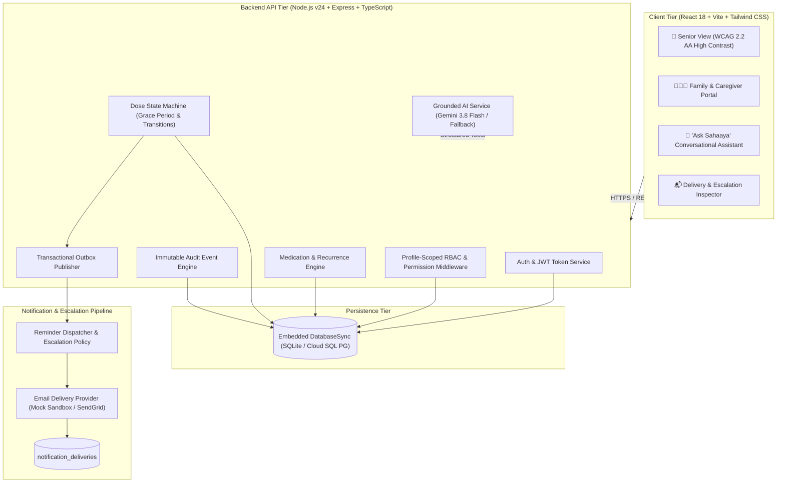

# Sahaaya Care — System Architecture Specification

## 1. High-Level Architecture

Sahaaya Care implements a consent-first, event-driven care coordination architecture designed to keep older adults in control of their routines while enabling authorized family members and caregivers to provide proactive support.

## 2. Core Subsystems

### A. Authentication & Cryptographic Passcode Redemption
- **Identity Provider**: Verified email + salted PBKDF2 password hashes / JWT token authentication.
- **Invitation Tokens**: Cryptographically random single-use tokens (`crypto.randomBytes(4).toString('hex')`). Only the SHA-256 hash is persisted in the database (`code_hash`).
- **Redemption & Binding**: Tokens are single-use, enforce expiration times (e.g., 48 hours), and bind the invitee to the designated care profile upon redemption.

### B. Dose State Machine & Grace Period Escalation
- `UPCOMING`: Scheduled in future.
- `DUE`: Reached scheduled time.
- `ACKNOWLEDGED_TAKEN`: User or caregiver verified medicine taken.
- `ACKNOWLEDGED_SKIPPED`: User or caregiver recorded intentional skip with reason.
- `UNABLE_TO_TAKE`: User was physically unable to take (nausea, supply outage).
- `OVERDUE_UNCONFIRMED`: Grace period (default 30 mins) elapsed without acknowledgement.
- `CANCELLED`: Prescription paused or archived.

### C. Transactional Outbox & Notification Dispatcher
- Domain mutations write both the domain entity and an `outbox_events` record in the same database transaction.
- The background dispatcher polls unpublished events, evaluates recipient permissions and notification preferences, generates unique idempotency keys (`idempotency_key = ${profileId}_${entityType}_${entityId}_${eventType}_${scheduledFor}`), and records delivery state.
- Transparent statuses: `QUEUED`, `SENT`, `DELIVERED`, `FAILED`, `RETRYING`.

### D. Grounded AI Assistant (Gemini 3.8 Flash)
- Grounded strictly in authenticated user data via backend tools (`get_today_care_plan`, `get_adherence_summary`, `get_upcoming_appointments`).
- System instruction strictly forbids diagnosing, prescribing, or recommending dosage alterations.
- If cloud AI credits or network connectivity are disrupted, deterministic fallback summaries automatically provide complete answers without disruption.
